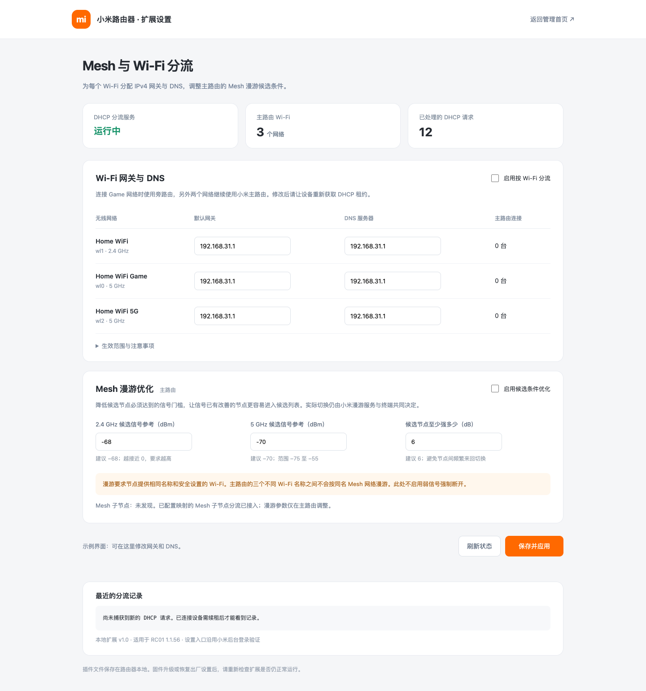

# Xiaomi Mesh Gateway

小米万兆路由器 RC01、原厂固件 1.1.56 的本地扩展：按 Wi-Fi 下发 IPv4 网关和 DNS，调整主路由 Mesh 漫游候选参数。其他机型和固件未经验证。



*示例界面使用虚构的 Wi-Fi 名称。*

## 一键安装

适用小米万兆路由器 RC01、原厂固件 1.1.56，LAN 地址为 `192.168.31.1`，并已开启 root SSH。通过 SSH 连接路由器后执行：

```sh
curl -fL https://github.com/liyongliao/xiaomi-mesh-gateway/releases/download/v1.0.0/install.sh -o /tmp/mesh-gateway-install.sh && sh /tmp/mesh-gateway-install.sh
```

脚本检查设备型号、固件、LAN 地址和已有安装；下载 Release 安装包并验证 SHA-256，备份漫游配置后启动插件。已有安装目录时会停止，以保护原配置；当前版本不支持自动覆盖升级。安装需要路由器能访问 GitHub。安装失败后若目录已创建，请检查日志及配置再手动处理，避免覆盖旧备份。

登录小米后台，点击右下角「Mesh 与 Wi-Fi 分流」。初始配置关闭分流和漫游调整，设置网关、DNS 后再启用。目标网关须在 `192.168.31.0/24` 且实际可访问；客户端重新获取 DHCP 租约后生效。IPv6、手动配置和加密 DNS 不受此功能控制。

### 手动下载或自行编译

[下载 Release 安装包和校验文件](https://github.com/liyongliao/xiaomi-mesh-gateway/releases/tag/v1.0.0)。也可自行编译 ARM64 程序：

```sh
go test ./src
CGO_ENABLED=0 GOOS=linux GOARCH=arm64 go build -trimpath -ldflags='-s -w' -o plugin/mesh-gateway ./src
```

自行编译后需将插件文件、备份及启动配置按 `install.sh` 的步骤部署到路由器。

## Mesh 子节点

默认不识别子节点。核对子节点 MAC、SSID 和无线接口后，在路由器 `/userdisk/mesh-gateway/config.json` 的 `mesh_nodes` 中填写映射，例如 `"02:00:00:00:00:01":{"wl0":"wl0","wl1":"wl1"}`，然后执行 `/etc/init.d/mesh-gateway restart`。示例 MAC 必须替换。子节点关联信息未同步时 DHCP 使用默认设置，同步后需重新获取租约。漫游参数只修改主路由，实际切换取决于终端和同名网络覆盖。

## 实现和恢复

通过 NFQUEUE 为 DHCP 请求添加标签，由原生 dnsmasq 分配地址及网关、DNS；进程不可用时采用 DHCP 默认配置。网页沿用小米后台登录。防火墙 include 负责恢复启动，固件升级及重启兼容性需自行验证。

执行 `/userdisk/mesh-gateway/service.sh stop` 可移除扩展的队列规则和启动配置，并恢复备份的漫游参数；客户端需重新获取租约。
